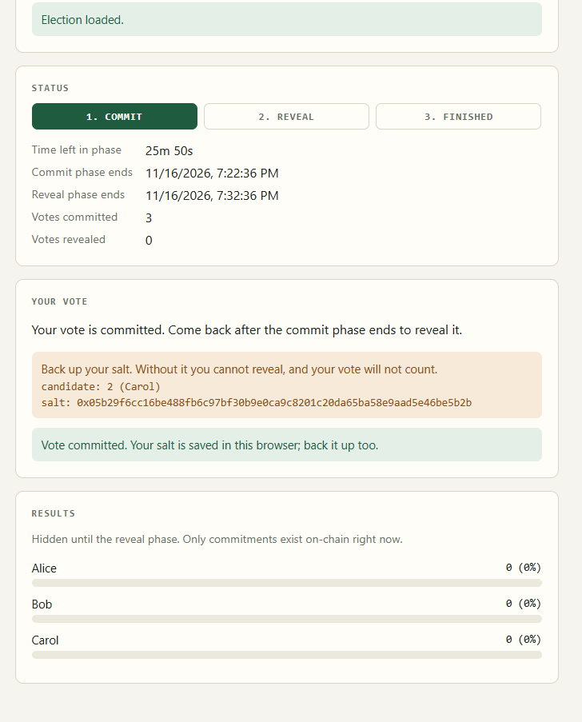
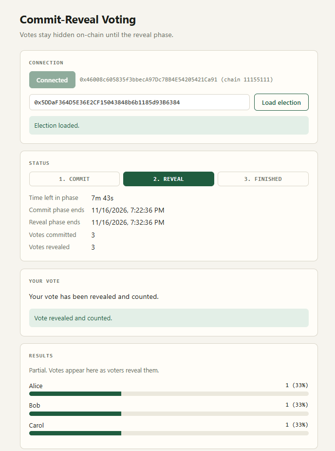
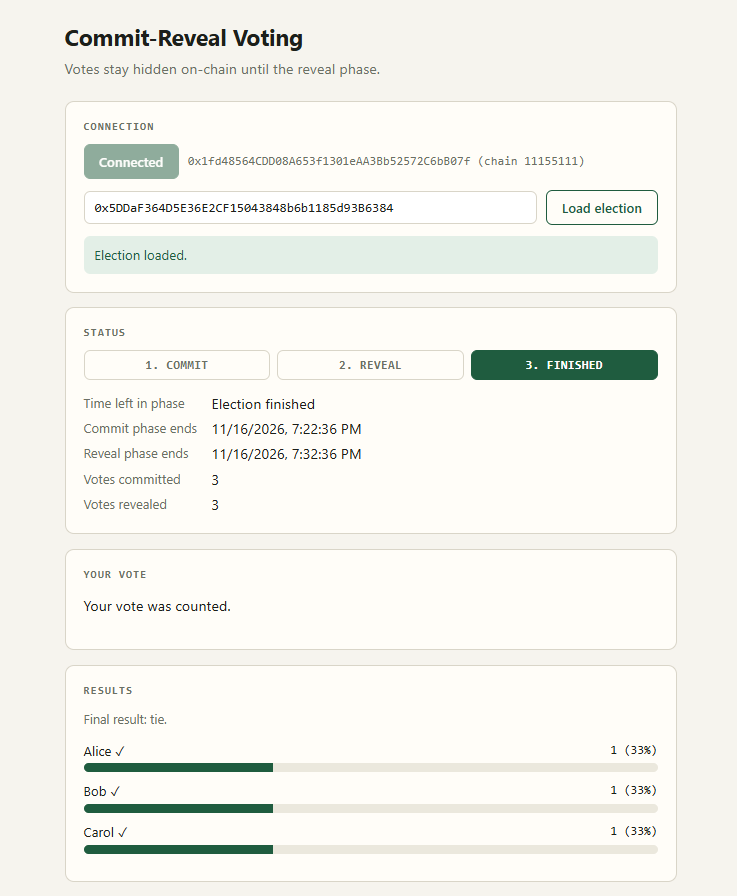
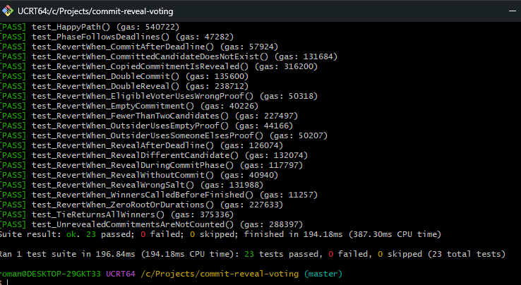

# Commit-Reveal Voting on Ethereum

A voting smart contract built around one question: **what can go wrong when votes live on a public blockchain, and which of those problems can the contract actually prevent?**

Everything on Ethereum is public, so a naive voting contract shows every vote the moment it is cast. Later voters can see the running tally and vote strategically. This project fixes that with a commit-reveal scheme, restricts voting to an allowlist using a Merkle tree, and tests each defence by attacking it.

## Live demo on Sepolia

The contract is deployed and source-verified on the Sepolia test network:
[`0x5DDaF364D5E36E2CF15043848b6b1185d93B6384`](https://sepolia.etherscan.io/address/0x5DDaF364D5E36E2CF15043848b6b1185d93B6384#code)

A full election was run against it with three allowlisted voters using the web frontend.

**1. Commit phase.** All three votes are on-chain, but only as hashes. The results are empty because nobody, including the contract, knows the votes yet.



**2. Reveal phase.** Each voter opens their commitment and the tally fills in.



**3. Finished.** The result is final. This run ended in a three-way tie, which `winners()` reports by returning every tied candidate.



**Tests.** 23 unit, attack and fuzz tests pass.



## How it works

| Phase | What voters do | What the chain shows |
|---|---|---|
| **Commit** | Submit `hash(chain, contract, voter, candidate, salt)` with a Merkle proof of eligibility | Who has voted, not how |
| **Reveal** | Submit the candidate and salt; the contract re-computes the hash and counts the vote if it matches | Each vote as it is revealed |
| **Finished** | Nothing. Results are final and `winners()` is available | Final tally |

Design decisions:

- **No owner, no admin functions.** Candidates, the voter allowlist and both deadlines are fixed in the constructor. There is no privileged key to steal and no way to alter a live election.
- **Merkle allowlist.** The contract stores one 32-byte root instead of every voter address. Voters prove membership when they commit.
- **Commitments are bound to the voter, contract and chain.** A copied commitment is useless to anyone else, and cannot be replayed in another election or on another network.
- **One commitment per voter, no changes.** This keeps the state machine small and easy to reason about.

## Threat model

### Defended (each has a test in `test/Election.t.sol`)

| Threat | Defence | Test |
|---|---|---|
| Voting without being eligible | Merkle proof checked against `msg.sender` | `test_RevertWhen_OutsiderUsesSomeoneElsesProof`, `testFuzz_NonVoterCannotCommit` |
| Voting twice | One commitment and one reveal per address | `test_RevertWhen_DoubleCommit`, `test_RevertWhen_DoubleReveal` |
| Seeing votes before voting closes | Only hashes are stored during the commit phase | By design |
| Changing a vote after seeing others | Reveal must match the stored hash exactly | `test_RevertWhen_RevealDifferentCandidate`, `testFuzz_OnlyExactOpeningReveals` |
| Copying someone's commitment and reusing their revealed salt | Hash includes the voter's address | `test_RevertWhen_CopiedCommitmentIsRevealed` |
| Replaying a commitment on another chain or election | Hash includes `block.chainid` and the contract address | By construction |
| Voting or revealing late | Phase checks on every state-changing call | `test_RevertWhen_CommitAfterDeadline`, `test_RevertWhen_RevealAfterDeadline` |
| Passing an internal Merkle node off as a leaf | Leaves are double-hashed | By construction |
| Admin tampering | No admin exists | By design |

### Not defended (known limitations)

- **No anonymity.** After the reveal, every vote is linked to an address forever. Fixing this needs zero-knowledge proofs (for example Semaphore or MACI).
- **Coercion and vote buying.** A voter can prove how they voted by sharing their salt. MACI is the standard answer.
- **Selective non-reveal.** Votes are revealed one at a time, so a late revealer can see the partial tally and choose to withhold their vote. They cannot change it, only drop it.
- **Weak salts.** With only a few candidates, a guessable salt lets anyone brute-force the commitment. The salt must be 32 random bytes.
- **RPC privacy.** Calling `computeCommitment` through a public RPC node sends that node your candidate and salt. Compute the hash locally instead (see below).
- **Trust in the allowlist.** The contract cannot tell whether the deployer built a fair voter list. Publish the list so anyone can recompute the root.
- **One address is not one person.** Sybil resistance depends entirely on how the allowlist is built.
- **Lost salt, lost vote.** There is no recovery.
- **Timestamp drift.** Validators can shift block timestamps by a few seconds, which only matters right at a deadline.

## Setup

Requires [Foundry](https://book.getfoundry.sh/getting-started/installation) and Node.js.

```bash
git init
forge install foundry-rs/forge-std OpenZeppelin/openzeppelin-contracts
npm install
forge build
forge test -vv
```

## Static analysis

```bash
pip install slither-analyzer
slither .
```

Slither 0.11.6 (102 detectors) run with `slither . --filter-paths "lib|test|script"` reported 3 results, none of them high or medium severity:

| Detector | Location | Assessment |
|---|---|---|
| `timestamp` | `phase()` compares `block.timestamp` to the two deadlines | **Accepted by design.** Phases have to be time-based. A validator can shift a block timestamp by a few seconds at most, which only matters for a vote sent right at a deadline and cannot change or expose any vote. Listed under known limitations above. |
| `cache-array-length` (2 results) | Both loops in `winners()` read `_tally.length` from storage on every iteration | **Fixed.** `winners()` now copies the tally into memory once and loops over that. This was a gas optimization, not a security issue. |

## Build the voter allowlist

```bash
cp voters.example.json voters.json   # then edit in real addresses
node tools/merkle.js voters.json
```

This prints the Merkle root and writes `proofs.json` with each voter's proof.

## Deploy to Sepolia

```bash
cp .env.example .env                 # fill in RPC URL, Etherscan key, VOTER_ROOT
source .env
forge script script/Deploy.s.sol --rpc-url $SEPOLIA_RPC_URL --broadcast \
  --verify --etherscan-api-key $ETHERSCAN_API_KEY --account <keystore-name>
```

Use a Foundry keystore (`cast wallet import`) rather than putting a private key in `.env`.

## Web frontend

`frontend/index.html` is a single-page app (ethers.js v6, no build step) for voting with MetaMask. It generates the salt and computes the commitment in the browser, so the vote is never sent to an RPC node before the reveal. Candidate names read from the chain are rendered as text only, never as HTML.

```bash
cp proofs.json frontend/proofs.json
py -m http.server 8000 --directory frontend
```

Then open `http://localhost:8000/?address=<election address>`. MetaMask does not work on pages opened directly from disk, which is why the local server is needed.

The salt is kept in the browser's local storage and shown to the voter to back up. Clearing browser data before revealing loses the vote unless the salt was saved.

## Voting from the command line

Compute the commitment locally so your vote never leaves your machine:

```bash
SALT=$(cast keccak $(openssl rand -hex 32))
COMMITMENT=$(cast keccak $(cast abi-encode "f(uint256,address,address,uint256,bytes32)" \
  11155111 $ELECTION $VOTER $CANDIDATE_ID $SALT))

cast send $ELECTION "commit(bytes32,bytes32[])" $COMMITMENT "[<proof from proofs.json>]" \
  --rpc-url $SEPOLIA_RPC_URL --account <keystore-name>

# after the commit deadline
cast send $ELECTION "reveal(uint256,bytes32)" $CANDIDATE_ID $SALT \
  --rpc-url $SEPOLIA_RPC_URL --account <keystore-name>
```

Keep `SALT` until you have revealed.

## Project layout

```
src/Election.sol        the contract
test/Election.t.sol     unit, attack and fuzz tests
script/Deploy.s.sol     deployment script
tools/merkle.js         builds the allowlist root and proofs
frontend/index.html     MetaMask voting page
```

## License

MIT
